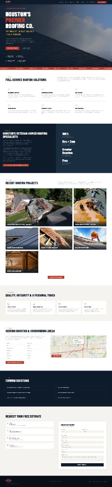

# Joseph Edwards · Web Experience & WordPress Engineering

I build customer-facing web experiences and the WordPress workflows behind them. These cases connect information hierarchy, responsive behavior, content discovery, CRM integration and privacy boundaries.

[Profile](https://github.com/RawPowered/RawPowered) · [Case walkthrough](docs/WALKTHROUGH.md) · [Evidence scope](docs/EVIDENCE.md) · [Next evidence to add](docs/ROADMAP.md) · [LinkedIn](https://www.linkedin.com/in/josephedwardscto/)

## Start here

| Case | What to inspect | Evidence boundary |
|---|---|---|
| [305UGC — current website & mobile journey](https://github.com/RawPowered/305UGC-Showcase) | Live public site; paired 1440px and 390px homepage captures; guided quote path; WordPress–Zoho architecture. | Portfolio build; CRM workflows and full customer-journey acceptance have documented pending checks. |
| [RoofRoofTexas — full rebuild](https://github.com/RawPowered/RoofRoofTexas-Rebuild) | Before/after architecture, conversion flow, responsive navigation, media pipeline, security hardening and local SEO. | Existing public case study; site claims are linked to its evidence and verification date. |
| [PowerPortals — WordPress portal product](https://github.com/RawPowered/PowerPortals-Showcase) | Fictional-data tour for modular intake, team portals and Zoho CRM companion widgets. | Private validation; no distributable software or compatibility/security certification. |
| [Zoho CRM widgets — product extension UX](https://github.com/RawPowered/Zoho-CRM-Widgets) | Fictional tours of CRM workspaces and embedded operational widgets. | Commercial source and licensed installation supplied privately; this is not a WordPress plugin. |

## In view

## Before and after: a legacy service site

The source repository describes a prior thin one-page site rebuilt with responsive service navigation, project proof, a request flow, media optimization and local-search structure. This is an earlier public case; its details and claims remain attributed to that case.

## Plugin and embedded workspace experience

These are **Zoho CRM widgets**, not WordPress plugins. The private PowerPortals WordPress source provides the plugin/portal implementation; the public tour shows its product direction with fictional data. Private source and licensed packages are not redistributed in this repository.

## Working approach

Clarify the user and business goal, identify the evidence source, make the interface and system boundary explicit, and document what was checked and what remains. These cases separate measured outcomes, implementation observations, private-source summaries and proposed follow-up work.

## More detail

[Open the case walkthrough](docs/WALKTHROUGH.md) for design and delivery rationale. [Review evidence, measurement limits, privacy and status](docs/EVIDENCE.md).

UI and capture evidence belongs to the cited live site or fictional-data product tour. Plugin source and commercial deployment assets remain private. A rendered tour does not claim a client installation has completed acceptance.

**Available for full-time and contract work.** [Connect on LinkedIn](https://www.linkedin.com/in/josephedwardscto/).
