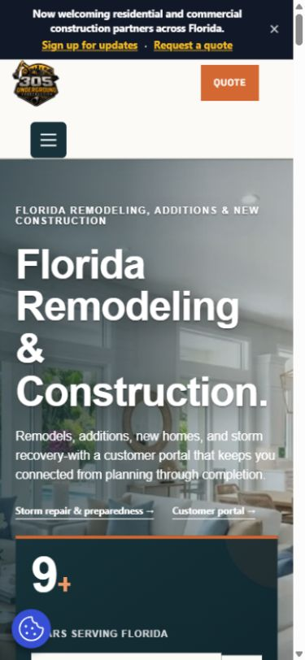

# Case review: one web journey across desktop and phone

**Desktop, 1440 × 1000:** the landing page introduces the service, proof content and paths to the quote and customer areas. [View the full public case](https://github.com/RawPowered/305UGC-Showcase).

**Mobile, 390 × 844:** the compact navigation and stacked content retain a clear quote path. These captures show layout at two viewports; they do not establish testing across all devices, assistive technologies or network conditions.

## Design decisions

- Put service choice and the next action near the first impression.
- Carry page-of-origin context into quote entry.
- Keep structured project intake connected to the workflow that must receive it.
- Separate signed-in identity from permission to access a particular customer or project.
- Use responsive grids, descriptive labels, reduced-motion behavior and accessible names in reviewed custom markup.

## Review boundaries

The public HTML includes multiple H1 elements from page/template markup. A complete review still needs keyboard focus order, screen-reader behavior, contrast, form errors and announcements. ARIA attributes and an inspected viewport do not establish WCAG conformance or observed usability results.

The 305UGC showcase documents that CRM round-trip acceptance, some retry and restore scenarios, and full customer-journey sign-off remained pending in the cited assessment. The site is presented as portfolio project work; funded employment is not implied.

## WordPress and plugin work

The private 305UGC and PowerPortals source repositories contain the respective WordPress implementations. The public PowerPortals product tour describes plugin-like portal modules and Zoho companion widgets using fictional records. **No private plugin source, installation package, client data or secret is copied here.** The public [Zoho CRM Widgets collection](https://github.com/RawPowered/Zoho-CRM-Widgets) is a CRM extension product, not a WordPress plugin; its tours have their own availability and validation notes.

## More to inspect

- [305UGC responsive capture and project status](https://github.com/RawPowered/305UGC-Showcase#desktop-to-mobile)
- [PowerPortals product tour](https://github.com/RawPowered/PowerPortals-Showcase#product-tour)
- [SEO, content and accessibility notes](https://github.com/RawPowered/305UGC-Showcase/blob/main/docs/SEO-ACCESSIBILITY-AND-DETAIL.md)
- [Security and privacy boundaries](https://github.com/RawPowered/305UGC-Showcase/blob/main/docs/SECURITY-PRACTICES.md)

[Return to overview](../README.md)
